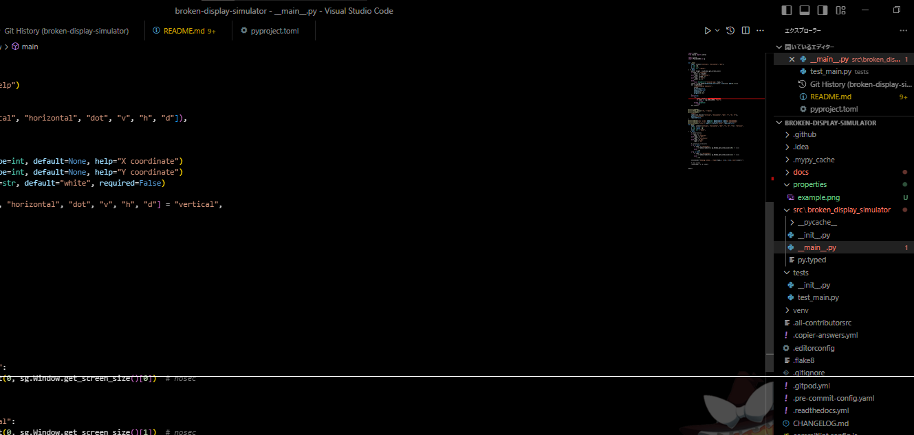

# Broken Display Simulator

<p align="center">
  <a href="https://github.com/34j/broken-display-simulator/actions/workflows/ci.yml?query=branch%3Amain">
    
  </a>
  <a href="https://broken-display-simulator.readthedocs.io">
    
  </a>
</p>
<p align="center">
  <a href="https://codecov.io/gh/34j/broken-display-simulator">
    
  </a>
  <a href="https://github.com/astral-sh/uv">
    
  </a>
  <a href="https://github.com/astral-sh/ruff">
    
  </a>
  <a href="https://github.com/j178/prek">
    
  </a>
</p>
<p align="center">
  <a href="https://pypi.org/project/broken-display-simulator/">
    
  </a>
  
  
</p>

---

**Documentation**: <a href="https://broken-display-simulator.readthedocs.io" target="_blank">https://broken-display-simulator.readthedocs.io </a>

**Source Code**: <a href="https://github.com/34j/broken-display-simulator" target="_blank">https://github.com/34j/broken-display-simulator </a>

---

Simulates broken display.



## Installation

Install this via pip (or your favourite package manager):

```shell
pip install broken-display-simulator
```

## Usage

The `bdsim` command below will cause annoying vertical lines to appear on the screen.

```shell
bdsim
```

Color and orientation/type can also be specified.

```shell
bdsim horizontal green
```

```shell
bdsim dot red -x 100 -y 100
```

```shell
> bdsim -h
Usage: bdsim [OPTIONS] [[vertical|horizontal|dot|v|h|d]] [COLOR]

Options:
  -h, --help       Show this message and exit.
  -x, --x INTEGER  X coordinate
  -y, --y INTEGER  Y coordinate
```
